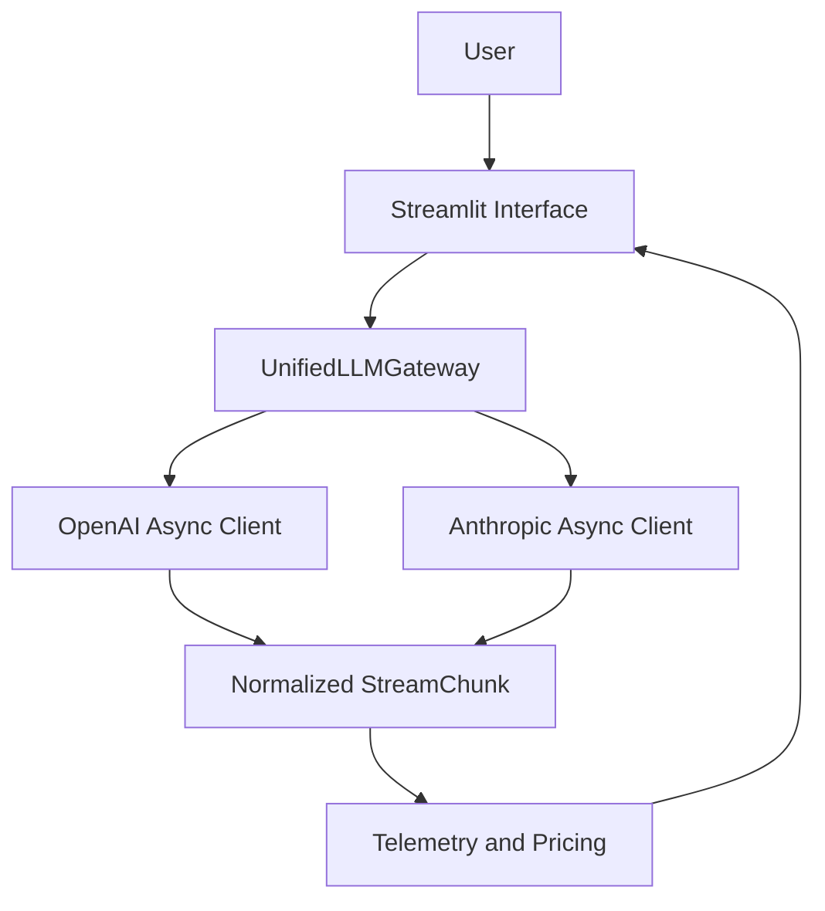

# Multi-Provider Async LLM Gateway

A Python application that provides a unified asynchronous streaming interface for OpenAI and Anthropic language models, with token usage, latency, throughput, and cost telemetry.

## Features

- Asynchronous streaming with official OpenAI and Anthropic SDKs
- Unified Pydantic response models
- Token accounting and estimated USD cost
- Time-to-first-token (TTFT) and generation speed measurements
- Interactive Streamlit interface
- Automated tests with mocked provider responses
- Error handling for missing credentials and provider failures

## Architecture



## Requirements

- Python 3.11 or newer
- uv package manager
- OpenAI and Anthropic API credentials for live requests

## Installation

Clone the repository and enter the project directory:

```bash
git clone YOUR_REPOSITORY_URL
cd multi-provider-llm-gateway
```

Install dependencies:

```bash
uv sync
```

## Configuration

Copy the example environment file:

```bash
cp .env.example .env
```

Edit `.env` and supply your API credentials:

```dotenv
OPENAI_API_KEY=your_openai_key_here
ANTHROPIC_API_KEY=your_anthropic_key_here
```

Never commit `.env` or real API keys to GitHub.

## Run the Application

From the project root:

```bash
PYTHONPATH=. uv run streamlit run src/app.py
```

Open http://localhost:8501 in your browser.

Select a model, adjust the temperature, enter a prompt, and click **Generate Response**.

The application streams response text and displays final request telemetry.

## Run Tests

```bash
uv run pytest -v
```

The automated tests use mocked API responses and do not require live API credentials.

## Telemetry

The gateway tracks:

- Input tokens
- Output tokens
- Total request latency
- Time to first nonempty text token
- Output tokens per second
- Estimated total request cost in USD

Provider usage metadata is preferred for token accounting. OpenAI also has a local tiktoken fallback when usage metadata is unavailable.

## Pricing Matrix

Configured USD prices per 1,000,000 tokens:

| Model | Input | Output |
|---|---:|---:|
| gpt-4o-mini | $0.15 | $0.60 |
| gpt-4o | $2.50 | $10.00 |
| claude-haiku-5-5 | $0.10 | $0.50 |
| claude-sonnet-5-5 | $2.00 | $10.00 |

These are the rates currently configured in `src/pricing.py`. Anthropic model identifiers and current official prices must be verified before a live demonstration.

## Security

- Credentials are read from environment variables.
- `.env` is excluded from Git tracking.
- Missing credentials produce a controlled error.
- Provider authentication, rate-limit, and connection errors are handled through custom exceptions.
- Tests verify that credential-like strings are not exposed in selected error paths.

## AI Audit and Verification

The project was initially developed with AI assistance and reviewed through automated tests and code inspection.

See `ai_prompt_log.md` for the original prompt, verified issues in the baseline implementation, corrections, and before-and-after code comparisons.

## Current Limitations

- Live provider requests have not yet been verified with API credentials.
- Streamed response text updates immediately, but telemetry currently appears after the request finishes.
- Anthropic temperature handling requires further verification against the installed SDK and supported model capabilities.
- Deployment has not yet been completed.
